# PANDUAN PENGGUNA SISTEM (USER MANUAL)
## SISTEM TINDAKAN SURAT MASUK (STSM)
**MAJLIS AGAMA ISLAM NEGERI SEMBILAN (MAINS)**

---

### MAKLUMAT PANDUAN
- **Versi**: 1.0 (Edisi Bergambar Rasmi)
- **Tarikh Kemaskini**: November 2026
- **Agensi**: Majlis Agama Islam Negeri Sembilan
- **Sasaran Pembaca**: Semua Warga Kerja MAINS (Pengurusan, Ketua Jabatan, Ketua Unit, Pegawai Daerah/Cawangan, Pegawai Pelaksana, Kerani Pendaftaran, dan Pentadbir Sistem)

---

## JADUAL KANDUNGAN
1. [Pengenalan Sistem](#1-pengenalan-sistem)
2. [Prasyarat & Akses ke Sistem](#2-prasyarat--akses-ke-sistem)
3. [Log Masuk & Pilihan Peranan Organisasi](#3-log-masuk--pilihan-peranan-organisasi)
4. [Navigasi & Susun Atur Antaramuka](#4-navigasi--susun-atur-antaramuka)
5. [Panduan Modul Pendaftaran Surat Masuk](#5-panduan-modul-pendaftaran-surat-masuk)
   - 5.1 Pendaftaran Surat Baharu (Mod Tunggal)
   - 5.2 Pengecaman Heuristik / AI Metadata Automatik
   - 5.3 Pendaftaran Pukal (Bulk Mode)
6. [Panduan Modul Peti Minit (Pengurusan Tindakan Surat)](#6-panduan-modul-peti-minit-pengurusan-tindakan-surat)
   - 6.1 Membaca & Melihat Butiran Surat (Laci Butiran)
   - 6.2 Meminitkan Arahan ke Bawah (Hierarki MAINS)
   - 6.3 Penggunaan Frasa Pantas (Quick Action Chips)
7. [Panduan Merekod Tindakan & Maklum Balas](#7-panduan-merekod-tindakan--maklum-balas)
   - 7.1 Kemaskini Status (Sedang / Telah Selesai)
   - 7.2 Melengkapkan Catatan Tindakan
   - 7.3 Pengesahan Maklum Balas & Tandatangan Digital
8. [Panduan Penjanaan & Cetakan Dokumen Rasmi](#8-panduan-penjanaan--cetakan-dokumen-rasmi)
   - 8.1 Menjana & Mencetak Slip Kod QR Pengesanan (Saiz A5)
   - 8.2 Mencetak Lembaran Minit Tindakan (Saiz A4)
9. [Panduan Pautan Surat Berkaitan (Link Surat)](#9-panduan-pautan-surat-berkaitan-link-surat)
10. [Panduan Modul Pemantauan SLA 14 Hari & Notifikasi](#10-panduan-modul-pemantauan-sla-14-hari--notifikasi)
    - 10.1 Memahami Status Warna SLA
    - 10.2 Menghantar Peringatan Segera (WhatsApp & Emel)
11. [Panduan Modul Analisis & Pelaporan](#11-panduan-modul-analisis--pelaporan)
12. [Panduan Modul Struktur Organisasi](#12-panduan-modul-struktur-organisasi)
13. [Panduan Modul Pentadbiran Sistem (Khusus Admin)](#13-panduan-modul-pentadbiran-sistem-khusus-admin)
    - 13.1 Pengurusan Pengguna
    - 13.2 Pengurusan Menu Dinamik
    - 13.3 Pengurusan Peranan & Matriks Kebenaran (RBAC)
    - 13.4 Tetapan Sistem & Tempoh SLA
    - 13.5 Konfigurasi Tema Visual Antaramuka
14. [Soalan Lazim (FAQ) & Penyelesaian Masalah](#14-soalan-lazim-faq--penyelesaian-masalah)

---

## 1. PENGENALAN SISTEM

Sistem Tindakan Surat Masuk (STSM) MAINS ialah platform digital terpadu yang dirangka khas untuk memperkasa tadbir urus penerimaan, pengagihan, pemantauan, dan penyelesaian surat rasmi di Majlis Agama Islam Negeri Sembilan.

### Faedah Utama Sistem:
- **Tiada Lagi Surat Tertinggal**: Penjejakan status automatik berpandukan Piagam Pelanggan MAINS (SLA 14 Hari).
- **Minit Pantas & Tepat**: Arahan disalurkan serta-merta mengikut struktur rasmi MAINS tanpa perlu menunggu edaran fizikal.
- **Slip Kod QR A5**: Fail fizikal di pejabat dipautkan dengan rekod digital melalui imbasan Kod QR.
- **Jejak Audit Lengkap**: Rekod telus bagi setiap pegawai yang melihat, meminitkan, dan menyelesaikan tindakan.

---

## 2. PRASYARAT & AKSES KE SISTEM

### 2.1 Keperluan Perkakasan & Pelayar Web
- **Pelayar Web Disyorkan**: Google Chrome (versi 110+), Microsoft Edge (versi 110+), atau Mozilla Firefox (terkini).
- **Resolusi Skrin**: 1280 x 720 piksel atau lebih tinggi (dioptimumkan untuk Desktop & Tablet).
- **Sambungan Rangkaian**: Akses ke rangkaian Intranet MAINS atau Internet yang stabil.

### 2.2 Alamat Pautan Sistem
- **URL Sistem**: `http://localhost:3000` (atau pautan portal rasmi agensi: `https://stsm.mains.gov.my`)
- **Backend API**: Beroperasi pada port `3001` dengan sambungan selamat ke pangkalan data Microsoft SQL Server MAINS.

---

## 3. LOG MASUK & PILIHAN PERANAN ORGANISASI

### 3.1 Langkah-langkah Log Masuk
1. Buka pelayar web dan layari alamat URL sistem.
2. Pada skrin log masuk, masukkan maklumat peribadi anda:
   - **Nama Pengguna (Username)**: Masukkan ID pengguna anda (contoh: `admin` atau ID staf).
   - **Kata Laluan (Password)**: Masukkan kata laluan anda.
3. Klik butang **"Log Masuk Sistem"**.
4. Sekiranya maklumat tepat, anda akan dibawa terus ke paparan Papan Pemuka Utama (Utama).

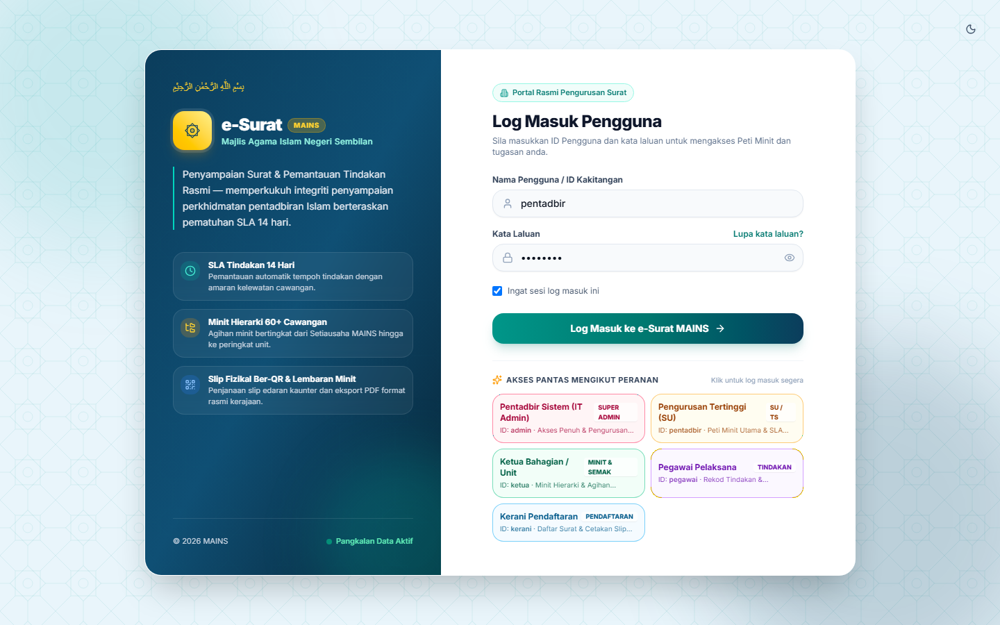
*Rajah 1: Antaramuka Log Masuk STSM dengan butang pilihan peranan pantas untuk demonstrasi dan pengujian sistem.*

> [!NOTE]
> Maklumat log masuk lalai untuk pengujian:
> - **Username**: `admin`
> - **Password**: `password`

### 3.2 Penukaran Peranan Pandangan Organisasi (Dropdown Peranan)
Bagi tujuan fleksibiliti aliran kerja (terutamanya pegawai yang memangku atau pentadbir yang menyelia bahagian):
- Di bahagian atas bar pengepala (header), terdapat menu pilihan **Peranan Bertindak** (contoh: *Setiausaha, Timbalan Setiausaha Operasi, Pengarah Zakat, Pegawai Daerah Seremban*).
- Memilih peranan akan menyesuaikan Peti Minit dan tindakan mengikut hak kuasa jawatan tersebut.

---

## 4. NAVIGASI & SUSUN ATUR ANTARAMUKA

Antaramuka STSM dibahagikan kepada komponen utama:
1. **Bar Sisi Kiri (Sidebar)**: Mengandungi menu modul mengikut kelayakan peranan pengguna (*Utama, Daftar Surat, Peti Minit, Pemantauan, Analisis, Struktur Organisasi, serta Menu Pentadbir*).
2. **Bar Pengepala Atas (Top Header)**: Memaparkan penunjuk peranan, notifikasi SLA segera, penukar tema mod gelap/cerah, dan butang log keluar.
3. **Kawasan Kerja Utama (Main Canvas)**: Menampilkan papan pemuka statistik metrik utama, amaran lewat, carta tren kemasukan, dan suapan aktiviti semasa.

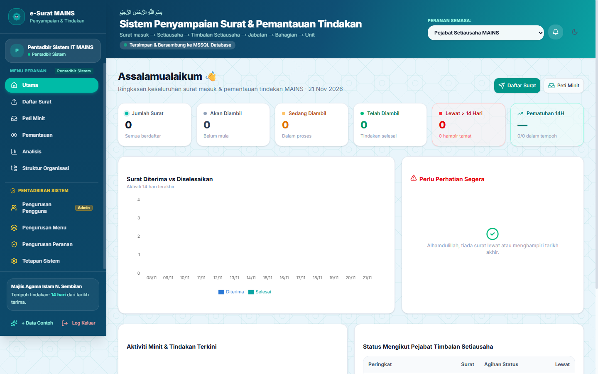
*Rajah 2: Papan Pemuka Utama memaparkan 4 kad statistik status SLA, amaran segera (<=3 hari), carta tren surat, dan suapan aktiviti terkini.*

---

## 5. PANDUAN MODUL PENDAFTARAN SURAT MASUK

Modul ini digunakan terutamanya oleh **Kerani Pejabat**, **Urusetia**, atau pegawai pentadbiran untuk merekod surat rasmi yang diterima.

### 5.1 Pendaftaran Surat Baharu (Mod Tunggal / Satu Surat)
1. Klik menu **"Daftar Surat"** pada bar sisi.
2. Pastikan tab **"Daftar Surat Tunggal"** dipilih.
3. **Muat Naik Lampiran Surat (Pilihan & Digalakkan)**:
   - Klik atau seret fail surat digital (PDF, JPG, PNG, DOCX) ke dalam kotak muat naik.
   - Sistem akan mengaktifkan fungsi **Pengecaman Heuristik Automatik**:
     * Sistem secara automatik membaca corak nama fail/kandungan dan mengisi ruangan *Perkara*, *Pengirim*, *No Rujukan*, dan *Kategori*!
4. **Semak dan Lengkapkan Maklumat Surat**:
   - **Nombor Daftar Masuk**: Dijana automatik oleh sistem (contoh: `MAINS/SU/2026/0001`).
   - **Nombor Rujukan Pengirim**: Masukkan no. rujukan surat rasmi pengirim (contoh: `JHEAINS/P/100-2/3`).
   - **Perkara / Tajuk Surat**: Tajuk penuh surat (Huruf besar/kecil diformatkan secara kemas automatik).
   - **Pengirim**: Nama jabatan, syarikat, atau individu yang menghantar.
   - **Tarikh Terima**: Tarikh surat diterima di pejabat (lalai: tarikh hari ini).
   - **Tarikh Surat**: Tarikh yang tertera pada surat pengirim.
   - **Kategori**: Pilih kategori yang bersesuaian (*Pentadbiran, Zakat, Wakaf, Kewangan, Aduan, Jemputan, ICT, Lain-lain*).
   - **Tahap Keutamaan**: Pilih *Biasa*, *Segera*, atau *Sangat Segera*.
   - **Catatan**: Sebarang nota ringkas tambahan.
5. Klik butang **"Daftar Surat Masuk"**.
6. Notifikasi kejayaan akan dipaparkan. Surat baharu kini rasmi didaftarkan dan dihantar terus ke **Peti Minit Pejabat Setiausaha MAINS**.

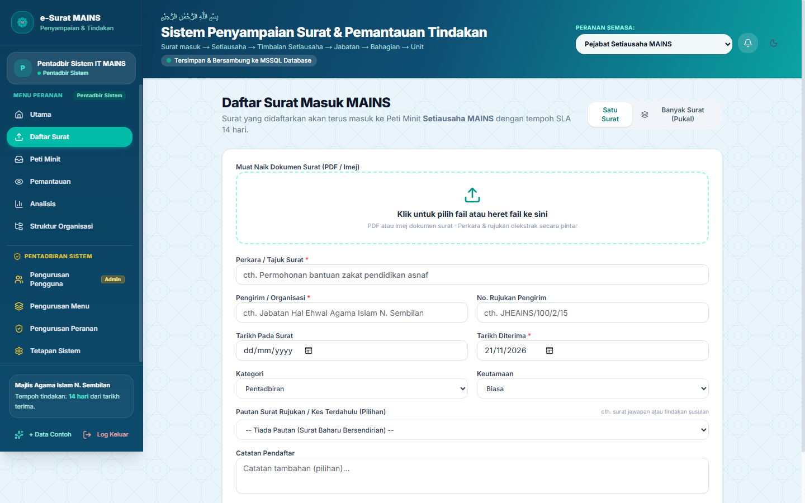
*Rajah 3: Borang pendaftaran surat masuk tunggal dengan sokongan ekstraksi fail heuristik dan auto-penomboran siri MAINS.*

---

## 6. PANDUAN MODUL PETI MINIT (PENGURUSAN TINDAKAN SURAT)

Peti Minit ialah ruang kerja harian bagi setiap pegawai dari peringkat Setiausaha hingga ke Pegawai Cawangan/Daerah.

### 6.1 Membaca & Melihat Butiran Surat (Laci Butiran)
1. Klik menu **"Peti Minit"** pada bar sisi.
2. Anda akan melihat 3 tab navigasi:
   - **Perlu Tindakan**: Surat yang sedang menunggu tindakan daripada anda.
   - **Diminitkan**: Surat yang telah anda turunkan arahannya kepada pegawai bawahan.
   - **Selesai**: Surat yang telah diambil tindakan dan selesai sepenuhnya.
3. Klik mana-mana baris surat untuk membuka **Laci Butiran Surat (Detail Drawer)**.

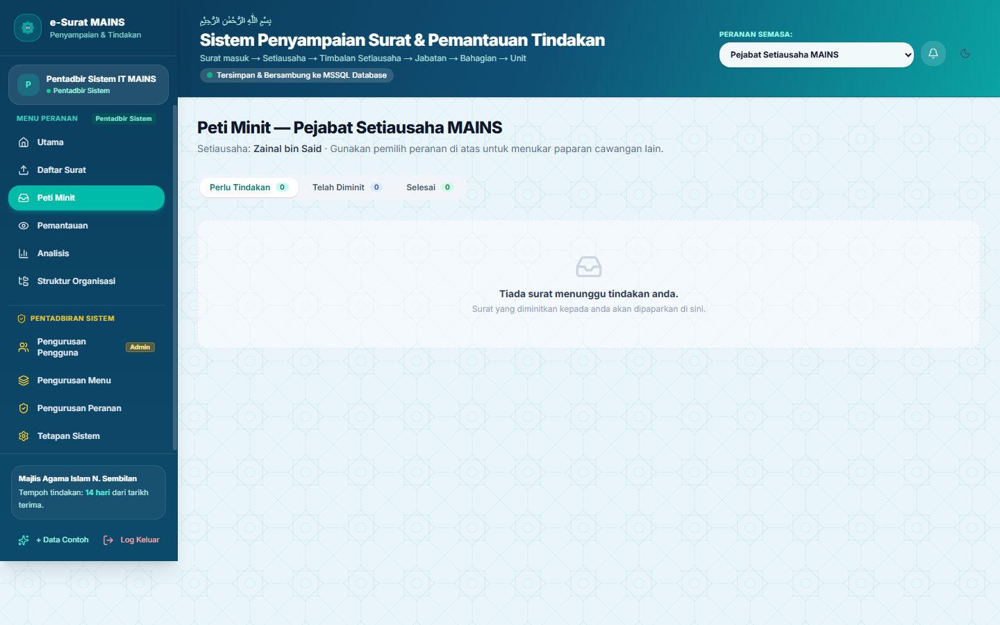
*Rajah 4: Senarai surat dalam Peti Minit dibahagikan mengikut tab Perlu Tindakan, Diminitkan, dan Selesai.*

*Rajah 5: Laci Butiran Surat memaparkan ringkasan lengkap surat, had SLA 14 hari, pautan lampiran fail, serta butang pintasan tindakan.*

### 6.2 Meminitkan Arahan ke Bawah (Hierarki MAINS)
Sebagai ketua jabatan, bahagian, atau unit yang menerima surat:
1. Pada senarai surat atau dalam Laci Butiran, klik butang **"Minitkan Arahan"** (ikon hantar ✉️).
2. Sistem akan membuka tetingkap **Minit Tindakan**.
3. **Pilih Pegawai / Unit Penerima**:
   - Sistem memaparkan senarai pegawai/unit bawahan yang sah mengikut hierarki MAINS.
   - Tandakan kotak pilihan pada satu atau beberapa penerima (contoh: pilih *Pengarah Jabatan Zakat* dan *Ketua Unit Agihan*).
4. **Masukkan Arahan Minit**:
   - Anda boleh menaip arahan khusus secara manual dalam ruangan teks arahan.
   - ATAU gunakan **Frasa Pantas (Quick Action Chips)** dengan mengklik butang cip yang disediakan:
     * *"Untuk tindakan segera"*
     * *"Sila ambil tindakan sewajarnya"*
     * *"Sila kaji & kemukakan syor"*
     * *"Untuk makluman & tindakan"*
     * *"Sila selaraskan & laporkan kepada saya"*
     * *"Sila hadir / wakilkan"*
     * *"Sila sediakan draf jawapan"*
5. Klik butang **"Hantar Minit Arahan"**.

*Rajah 6: Tetingkap penurunan minit arahan dengan hierarki penerima MAINS dan pilihan cip arahan pantas.*

---

## 7. PANDUAN MEREKOD TINDAKAN & MAKLUM BALAS

Apabila pegawai pelaksana atau unit berkaitan telah melaksanakan arahan yang diminitkan:

### 7.1 Mengemas Kini Status Tindakan
1. Buka surat yang berkaitan dalam Peti Minit.
2. Klik butang **"Rekod Tindakan"**.
3. Pilih status tindakan terkini:
   - 🟡 **Sedang Diambil Tindakan**: Sekiranya tindakan sedang dalam siasatan, penyelarasan, atau penyediaan draf.
   - 🟢 **Telah Selesai**: Sekiranya tindakan fizikal/urusan surat telah selesai sepenuhnya.

### 7.2 Melengkapkan Catatan Tindakan Selesai
1. Sekiranya anda memilih status **"Telah Selesai"**, ruangan **Catatan Tindakan** adalah mandatori.
2. Nyatakan dengan jelas tindakan yang telah diambil.
3. Klik **"Simpan Rekod Tindakan"**.

*Rajah 7: Borang pengemaskinian status tindakan kepada Sedang atau Telah Diambil Tindakan berserta ulasan penyelesaian.*

---

## 8. PANDUAN PENJANAAN & CETAKAN DOKUMEN RASMI

Sistem menyediakan fungsi cetakan dokumen fizikal piawai kerajaan yang diselaraskan dengan rekod digital.

### 8.1 Menjana & Mencetak Slip Kod QR Pengesanan (Saiz A5)
Slip ini bertujuan untuk dilekatkan pada kulit fail fizikal surat:
1. Buka butiran surat dan klik butang **"Cetak Slip QR"** (ikon pencetak 🖨️).
2. Sistem akan memaparkan pratonton **Slip Pengesanan Surat Masuk (Format A5)**:
   - Mengandungi Kod QR pengesanan unik beresolusi tinggi.
   - Nombor Daftar Surat dan Nombor Rujukan Pengirim.
   - Tarikh Terima dan Tarikh Had Masa SLA (14 Hari).
   - Pengirim dan Perkara Surat.
   - Ruangan tandatangan penerima fail fizikal.
3. Klik butang **"Cetak Slip"**. Dialog cetakan pelayar akan dibuka dengan susun atur format kertas A5 secara automatik.

*Rajah 8: Slip Pengesanan Surat Masuk A5 lengkap dengan Kod QR pengesanan fail fizikal dan kiraan tamat tempoh SLA 14 Hari.*

> [!TIP]
> Imbasan Kod QR pada slip menggunakan telefon pintar atau tablet akan terus membuka rekod status surat dalam sistem STSM!

### 8.2 Mencetak Lembaran Minit Tindakan (Saiz A4)
Lembaran minit fizikal diperlukan untuk simpanan dalam fail rasmi jabatan:
1. Buka butiran surat dan klik butang **"Lembaran Minit"**.
2. Sistem memaparkan format borang minit rasmi MAINS bersaiz A4 yang menyenaraikan:
   - Kepala surat rasmi Majlis Agama Islam Negeri Sembilan.
   - Butiran penuh pendaftaran surat masuk.
   - Jadual kronologi minit arahan lengkap daripada Setiausaha hingga ke pegawai pelaksana berserta tarikh dan catatan.
3. Klik butang **"Cetak Lembaran Minit"** untuk mencetak terus ke pencetak fizikal, atau klik **"Muat Turun PDF"** untuk menyimpan salinan digital.

*Rajah 9: Format cetakan Lembaran Minit A4 dengan jadual rekod kronologi penurunan arahan berhierarki.*

---

## 9. PANDUAN PAUTAN SURAT BERKAITAN (LINK SURAT)

Sekiranya terdapat surat susulan, surat jawapan, atau rayuan yang berkaitan dengan surat yang pernah diterima sebelum ini:
1. Buka butiran surat susulan berkenaan.
2. Klik butang **"Pautkan Surat"** (ikon rantai 🔗).
3. Tetingkap carian surat akan dibuka:
   - Taipkan Nombor Daftar, Nombor Rujukan Pengirim, atau Tajuk Perkara surat asal yang ingin dipautkan.
4. Pilih surat induk daripada senarai keputusan carian.
5. Klik **"Sahkan Pautan Surat"**.

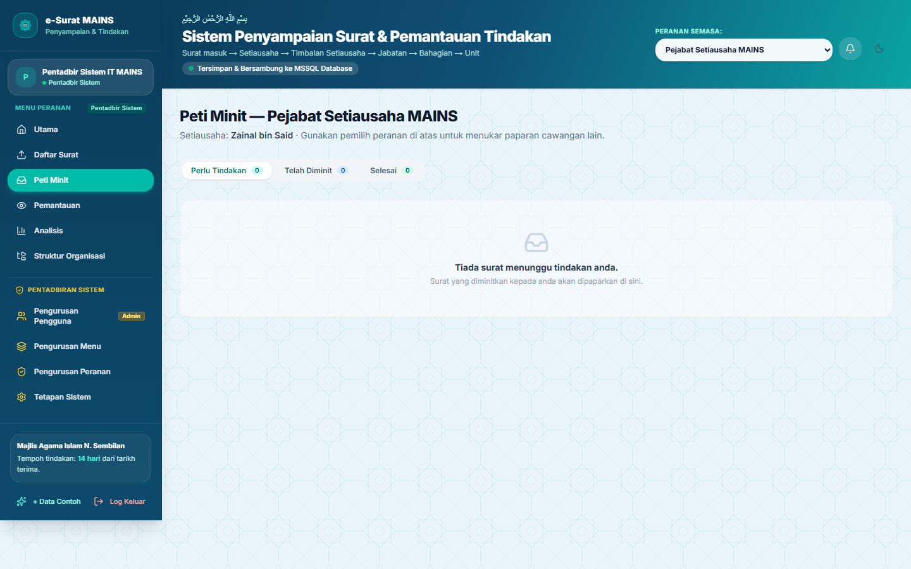
*Rajah 10: Modal carian dan pemautan surat rujukan terdahulu bagi tujuan semakan rujukan silang pantas.*

---

## 10. PANDUAN MODUL PEMANTAUAN SLA 14 HARI & NOTIFIKASI

Modul Pemantauan membolehkan pihak pengurusan dan pegawai memantau pematuhan Piagam Pelanggan MAINS (SLA 14 Hari).

### 10.1 Memahami Status & Petunjuk Warna SLA
- 🟢 **Telah Diambil Tindakan (Hijau)**: Tindakan telah diselesaikan sepenuhnya dalam tempoh 14 hari.
- 🟡 **Sedang Diambil Tindakan (Kuning/Jingga)**: Surat sedang diproses oleh pegawai bertindak.
- ⚪ **Akan Diambil Tindakan (Kelabu)**: Surat baru diagihkan dan belum dimulakan.
- 🔴 **Lewat > 14 Hari (Merah)**: Surat telah melepasi had masa 14 hari dari tarikh terima dan BELUM selesai.
- ⚠️ **Amaran Baki Hari (Baki <= 3 Hari)**: Lencana amaran segera dipaparkan untuk mengingatkan pegawai.

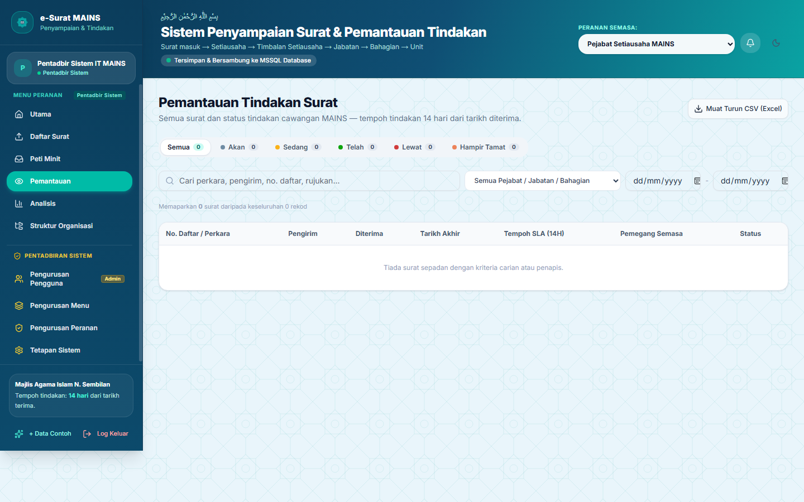
*Rajah 11: Jadual pemantauan status surat cawangan MAINS dengan penunjuk baki hari SLA dan butang notifikasi peringatan.*

---

## 11. PANDUAN MODUL ANALISIS & PELAPORAN

Modul Analisis memaparkan statistik visual berimpak tinggi:
1. Klik menu **"Analisis"** pada bar sisi.
2. Anda boleh menapis data mengikut tempoh masa: **Harian**, **Mingguan**, **Bulanan**, atau **Tahunan**.
3. Komponen analisis merangkumi peratusan kadar pematuhan SLA, carta bar kemasukan surat bulanan, taburan kategori surat, dan perbandingan prestasi bahagian/daerah.

*Rajah 12: Laporan analitik kepatuhan SLA 14 hari, taburan kategori surat, dan graf prestasi antara jabatan.*

---

## 12. PANDUAN MODUL STRUKTUR ORGANISASI

1. Klik menu **"Struktur Organisasi"** pada bar sisi.
2. Paparan pokok hierarki rasmi MAINS akan dipaparkan:
   - Menara MAINS -> Pejabat Setiausaha -> TSO & TSP -> Jabatan -> Bahagian -> Unit -> 11 Pejabat Daerah & Cawangan.
3. Klik mana-mana nod organisasi untuk melihat maklumat terperinci penyandang jawatan, nombor telefon, WhatsApp, dan emel rasmi.

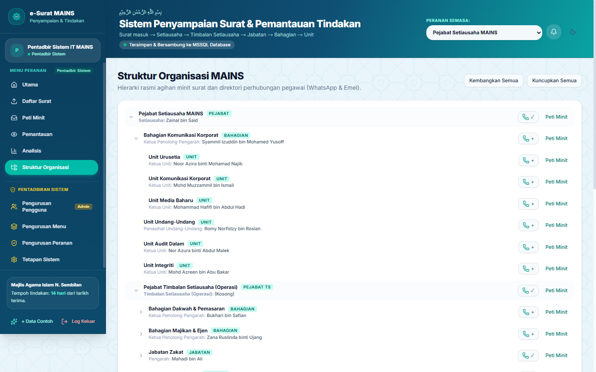
*Rajah 13: Pokok hierarki agihan minit rasmi MAINS dan direktori saluran perhubungan pegawai cawangan/daerah.*

---

## 13. PANDUAN MODUL PENTADBIRAN SISTEM (KHUSUS ADMIN)

Modul ini hanya boleh diakses oleh pengguna yang mempunyai peranan `pentadbir_sistem`.

### 13.1 Pengurusan Pengguna
- Menambah kakitangan baharu, menyunting peranan, mengemas kini bahagian penempatan, dan menetapkan semula (*reset*) kata laluan.

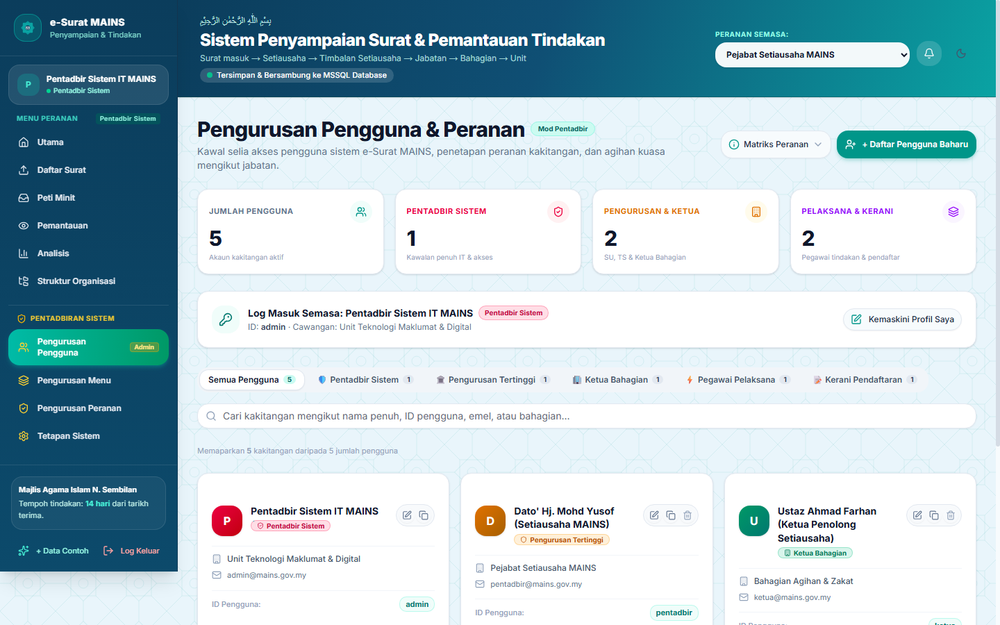
*Rajah 14: Direktori kakitangan sistem STSM untuk pendaftaran pengguna baharu dan kawalan status akaun.*

### 13.2 Pengurusan Menu Dinamik
- Pentadbir boleh menetapkan keterlihatan setiap menu pada bar sisi mengikut peranan (*Pentadbir, Pengurusan, Ketua Unit, Pegawai Pelaksana, Kerani*) dengan menogol kotak semak.

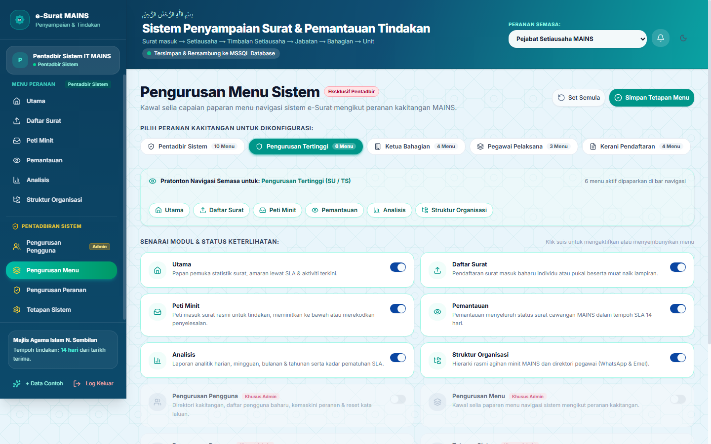
*Rajah 15: Antaramuka kawal selia keterlihatan menu navigasi sistem berasaskan peranan.*

### 13.3 Pengurusan Peranan & Matriks Kebenaran (RBAC)
- Memaparkan matriks 12 kebenaran hak kuasa untuk dikawal selia secara langsung mengikut keperluan keselamatan agensi.

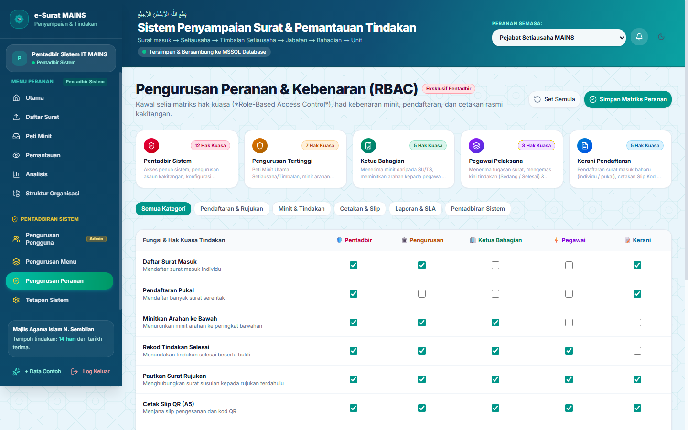
*Rajah 16: Matriks penetapan hak akses 12 modul kuasa mengikut 5 kategori peranan utama.*

### 13.4 & 13.5 Tetapan Sistem, Tempoh SLA & Tema Visual
- Mengkonfigurasi tempoh SLA piawai (14 hari), maklumat surat-menyurat Menara MAINS, memantau kesihatan pangkalan data MSSQL dan storan OBS, serta mengubah suai tema warna visual antaramuka.

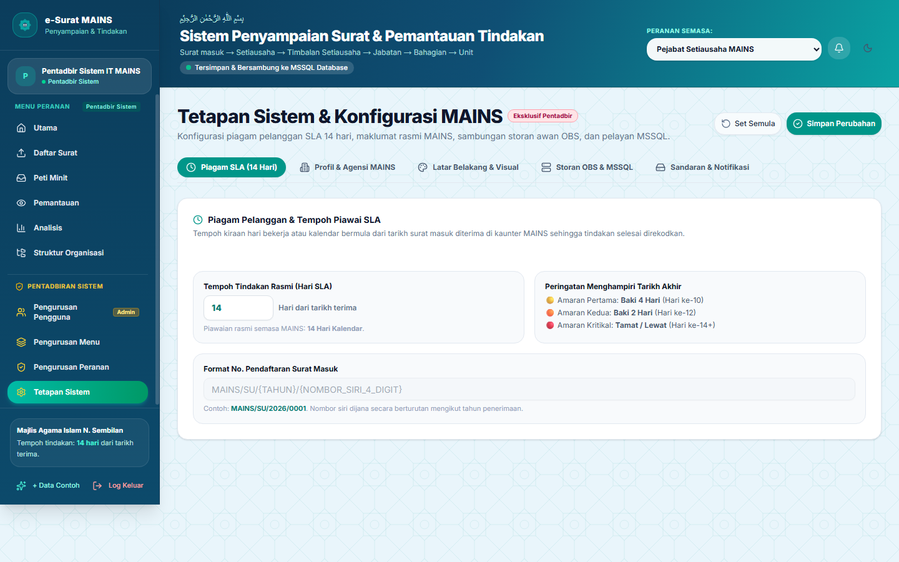
*Rajah 17: Tetapan parameter operasi agensi, tempoh had masa SLA, dan pemantauan pelayan pangkalan data.*

---

## 14. SOALAN LAZIM (FAQ) & PENYELESAIAN MASALAH

### Q1: Apakah yang perlu saya lakukan jika terlupa kata laluan?
> **Jawapan**: Sila hubungi Pentadbir Sistem (Bahagian Teknologi Maklumat MAINS) untuk melaksanakan penetapan semula (*password reset*) kepada kata laluan sementara.

### Q2: Bolehkah surat yang telah selesai dibuka semula untuk tindakan susulan?
> **Jawapan**: Ya, pihak pengurusan atau ketua unit boleh meminitkan arahan baharu pada surat tersebut sekiranya terdapat maklumat baharu yang memerlukan tindakan susulan.

### Q3: Mengapa sistem menolak fail lampiran yang saya muat naik?
> **Jawapan**: Pastikan format fail adalah `.pdf`, `.jpg`, `.jpeg`, `.png`, `.doc`, `.docx`, atau `.xls` dan saiz fail tidak melebihi **10MB**.

### Q4: Bagaimanakah cara untuk mencetak Kod QR bersaiz A5 dengan tepat?
> **Jawapan**: Pada tetingkap dialog cetakan pelayar web (*Print Preview*), pastikan pilihan *Paper Size* ditetapkan kepada **A5** dan *Orientation* disetkan kepada **Portrait** atau **Landscape** mengikut format yang dipaparkan.

---
*Dokumen Tamat. Disediakan untuk Kegunaan Rasmi Majlis Agama Islam Negeri Sembilan (MAINS).*
